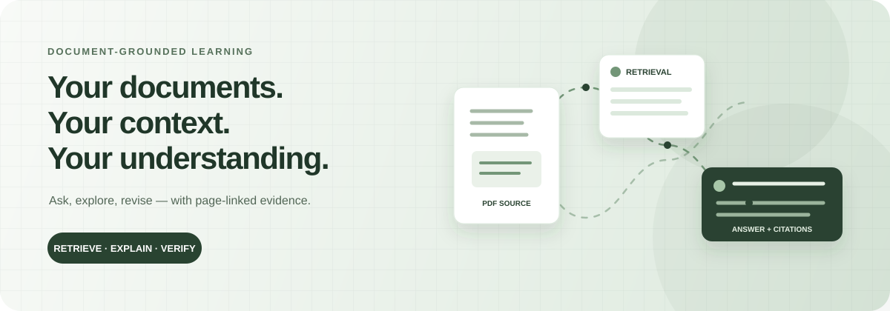
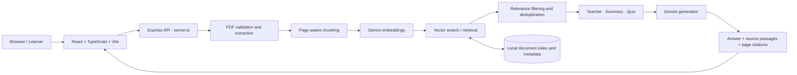
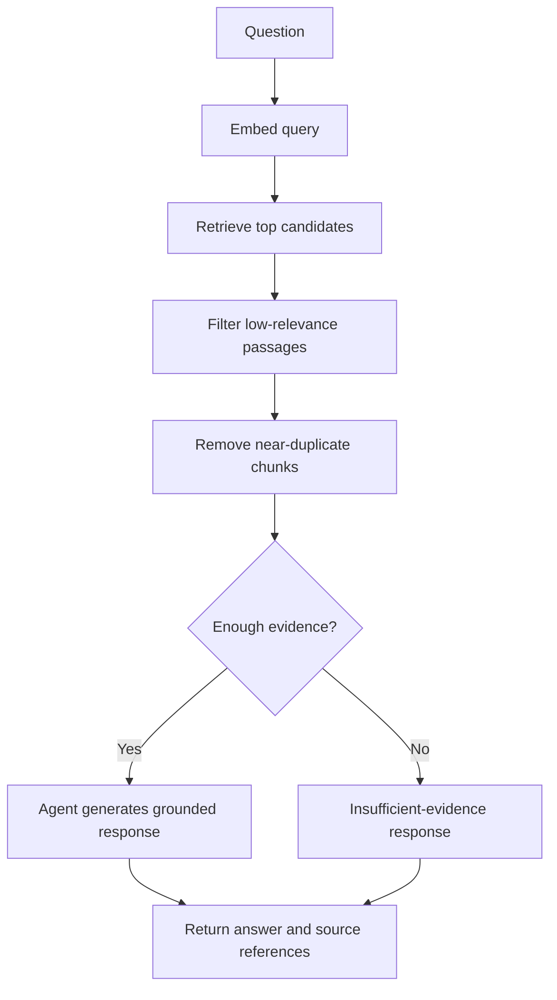

<!-- Animated hero: SVG uses subtle motion and respects reduced-motion preferences. -->
<p align="center">
  
</p>

<h1 align="center">Contexta AI</h1>
<p align="center"><strong>A document-grounded AI learning workspace for PDFs.</strong><br/>Turn dense study material into explanations, structured summaries, and interactive quizzes — with source passages you can inspect.</p>

<p align="center">
  <a href="https://contexta-ai-ipbi.onrender.com/"></a>
  <a href="https://github.com/Ankitkumar06102005/contextaAI"></a>
  
  
</p>

<p align="center">
  <a href="#quick-start">Quick start</a> · <a href="#architecture">Architecture</a> · <a href="#api-reference">API reference</a> · <a href="#testing-and-benchmarks">Testing & benchmarks</a> · <a href="#deployment-and-operations">Deployment</a>
</p>

---

## What is Contexta AI?

Contexta AI is an AI-assisted study companion that lets a learner ask questions about their own PDF material. Its intended differentiator is **traceability**: answers can include page-linked evidence, and the source inspector lets users review the retrieved passage instead of treating model output as unquestionable truth.

### Product capabilities

| Capability | What it does | Evidence / boundary |
|---|---|---|
| PDF ingestion | Accepts PDFs, extracts page text, creates chunks and indexes them | Text-based PDFs are the primary target; image-only/scanned PDFs may have no extractable text |
| Teacher agent | Explains concepts and answers document questions | Grounding depends on retrieval quality and model behavior; always inspect citations |
| Summary agent | Produces structured summaries and revision takeaways | Output quality depends on source coverage and model output |
| Quiz Genie | Generates multiple-choice questions with difficulty selection | Treat generated questions and answer keys as AI-generated study aids |
| Source inspector | Shows retrieved passages, chunk identifiers and page metadata | Lets a learner verify whether evidence supports the answer |
| Document lifecycle | Supports deleting a document and its stored index/metadata | Deletion applies to artifacts managed by the app; verify storage and deployment configuration |

## Product tour

1. **Upload** a PDF (maximum configured size: 25 MB).
2. **Index** the extracted text into overlapping chunks and vector embeddings.
3. **Ask** a question or request a summary/quiz.
4. **Retrieve** candidate passages and filter weak or repetitive evidence.
5. **Review** the response alongside page-linked source passages.
6. **Revise** using explanations and quizzes, then verify important claims against the original document.

## Architecture

The repository contains a TypeScript/Express full-stack application and a Python/FastAPI RAG implementation. The Render service configuration in this repository runs the Node/Express application; the Python API is separately runnable. Keep these paths distinct when testing or deploying changes.



### Retrieval flow



### Main technologies

| Layer | Technology | Role |
|---|---|---|
| UI | React, TypeScript, Vite | Landing page, workspace, chat, quiz and source inspection |
| UI motion / rendering | Motion, Markdown-It, KaTeX, Mermaid, DOMPurify | Interface animation, formatted responses, math/diagrams and HTML sanitization |
| Web server | Node.js, Express, Multer | Routes, PDF uploads, request handling and serving the frontend |
| Model integration | Google GenAI SDK / Gemini | Embeddings and generated explanations, summaries and quizzes |
| Retrieval | Vector similarity, chunk metadata and relevance filtering | Select candidate passages for document-grounded responses |
| Python service | FastAPI, pypdf, NumPy, FAISS, google-genai | Alternate/separate Python RAG API implementation |
| Deployment | Docker, Render blueprint | Containerized Node service and health-check configuration |

> **Model configuration note:** defaults and SDK availability can change. Check `config.py`, `server.ts`, and your provider's current model catalogue before changing model identifiers. Do not commit API keys.

## Repository map

```text
.
├── src/                    # React + TypeScript user interface
│   ├── App.tsx             # App-level controller
│   ├── types.ts            # Frontend domain types
│   ├── index.css           # Design tokens and global styling
│   └── components/         # Landing, workspace, chat, quiz, sources, navigation
├── server.ts               # Express full-stack server and Node-side AI/RAG flow
├── package.json            # Scripts and JavaScript dependencies
├── vite.config.ts          # Vite configuration
├── Dockerfile              # Multi-stage container build
├── render.yaml             # Render service blueprint
├── main.py                 # Separate FastAPI application
├── config.py               # Python RAG configuration
├── agents/                 # Python teacher, summary, quiz and router modules
├── rag/                    # Python PDF extraction, chunking, embeddings, FAISS retrieval
├── tests/verify_all.ts     # Node-side verification suite
├── requirements.txt        # Python service dependencies
├── .env.example            # Environment-variable template (review before use)
└── data/                   # Runtime document indexes/metadata; do not commit user files
```

## Quick start

### Requirements

- Node.js 22 recommended (matches the Dockerfile runtime) and npm.
- Python 3.10+ for the separate FastAPI implementation.
- A Gemini API key for live model-backed features.
- Git and a code editor such as VS Code.

### 1. Clone and install the web app

```bash
git clone https://github.com/Ankitkumar06102005/contextaAI.git
cd contextaAI
npm install
```

Create a local `.env` file from the template if one is present, then set the server-side key:

```dotenv
GEMINI_API_KEY=your_key_here
NODE_ENV=development
PORT=3000
```

Keep `.env` private. Never place provider secrets in frontend variables such as `VITE_*`, screenshots, issues, logs or commits.

### 2. Start the full-stack application

```bash
npm run dev
```

Open <http://localhost:3000>. The Express server mounts the Vite development server; use the scripts in `package.json` as the source of truth.

### 3. Build and verify the frontend

```bash
npm run build
npm run lint
npm test
```

The verification suite in `tests/verify_all.ts` expects the app at port 3000 or attempts to start the server itself. Review its console output and exit code; do not infer a pass merely because the command started.

### 4. Run the separate Python API

```bash
python -m venv .venv
# Windows PowerShell
.\.venv\Scripts\Activate.ps1
# macOS / Linux
# source .venv/bin/activate

pip install -r requirements.txt
```

Set `GEMINI_API_KEY` in your local environment, then run:

```bash
uvicorn main:app --reload --port 8000
```

- Health check: <http://127.0.0.1:8000/health>
- Interactive API documentation: <http://127.0.0.1:8000/docs>

The Node service and Python API are separate implementations. Do not assume that changing one automatically changes the other or that the live Render deployment uses the Python API.

## API reference

The Python FastAPI implementation exposes the following routes in `main.py`. The deployed Node service has its own route handlers in `server.ts`; confirm that file before assuming the exact response schema is identical.

| Method | Route | Purpose |
|---|---|---|
| `GET` | `/health` | Health and configured model information |
| `POST` | `/upload` | Validate, extract and index a PDF |
| `POST` | `/chat` | Route a question to an agent and retrieve source passages |
| `POST` | `/summary` | Generate a document summary |
| `POST` | `/quiz` | Generate MCQs with configurable difficulty |
| `DELETE` | `/document/{doc_id}` | Delete a document's stored artifacts |

### Example: upload a PDF (Python API)

```bash
curl -X POST http://127.0.0.1:8000/upload \
  -F "file=@./sample.pdf"
```

Use the returned `doc_id` for subsequent requests. Example chat payload:

```json
{
  "doc_id": "YOUR_RETURNED_DOC_ID",
  "message": "Explain the main idea and cite the relevant pages."
}
```

Example quiz payload:

```json
{
  "doc_id": "YOUR_RETURNED_DOC_ID",
  "num_questions": 5,
  "difficulty": "medium"
}
```

Use the live OpenAPI page or inspect `main.py` and `server.ts` for the authoritative request/response schemas before integrating another client.

## Testing and benchmarks

### What is present in the repository

- `npm test` runs `tsx tests/verify_all.ts`, a custom verification suite whose source currently declares **13 checks**.
- `npm run build` builds the Vite frontend.
- `npm run lint` runs TypeScript's `tsc --noEmit` check.
- The Python RAG modules include measurable stages for query embedding, vector search and filtering (`rag/retriever.py`).

**A test count is not the same as a passing test run.** This README does not claim that all 13 checks currently pass; run the commands on the target commit and retain the output/CI result.

### Performance metrics: report measured results, not guesses

No reproducible, verified end-to-end benchmark results are recorded here yet. The repository instruments parts of Python retrieval, but that is not sufficient to claim a global latency, accuracy, throughput, or cost figure for the deployed application. Do not add invented “99% accurate”, “sub-second”, “production-grade”, or “X users” claims.

For a meaningful benchmark, record at least:

| Metric | How to measure | Report with |
|---|---|---|
| Upload/index latency | Time upload request until indexing response completes | PDF page count, bytes, chunk count, warm/cold run |
| Query latency | Time each request end-to-end | Model, deployment region, concurrency, p50/p95/p99 |
| Retrieval latency | Use existing embedding/search/filter timings where available | Number of indexed chunks and top-k setting |
| Retrieval quality | Label relevant passages for a fixed question set; compute Recall@k / MRR | Dataset size and relevance rubric |
| Citation support | Manually or programmatically check each citation against its source page | Sample size, unsupported-citation rate |
| Answer quality | Use a reviewed question/answer set and a stated rubric | Groundedness, completeness, abstention behavior |
| Reliability | Run repeated requests and record success/error/timeout rates | Total requests, duration, model/API failures |
| Resource and cost | Track memory, CPU, token usage and provider charges | Hardware, model, input/output token counts |

Suggested benchmark procedure:

1. Prepare a small, non-sensitive, versioned PDF set and a fixed set of answerable and unanswerable questions.
2. Run at least one warm-up and then multiple repetitions per question.
3. Store raw timings and failures in CSV/JSON; report sample size and p50/p95/p99 rather than only an average.
4. Check citations against the original page text, and explicitly test questions whose answers are absent.
5. Repeat after changes to chunking, embedding models, top-k, relevance threshold or prompts.
6. Publish the dataset description, command, environment, commit SHA and raw results alongside any headline metric.

A benchmark table should only be filled after the run:

| Commit | Dataset / queries | p50 / p95 latency | Recall@5 | Citation support | Error rate |
|---|---|---|---|---|---|
| _Not measured in this README_ | — | — | — | — | — |

## Deployment and operations

The repository includes a multi-stage `Dockerfile` and a `render.yaml` blueprint for the Node service.

1. Connect the GitHub repository in Render and deploy the blueprint or Docker web service.
2. Set `GEMINI_API_KEY` as a **secret environment variable** in Render; do not put it in the repository.
3. Check the configured health route and inspect deployment logs after each release.
4. Verify the actual public URL, upload a small test PDF, ask a question, check source pages, generate a quiz, and delete the test document.
5. Confirm the persistent-disk configuration before relying on saved indexes across restarts.

**Storage warning:** local filesystem data may be ephemeral on hosted platforms unless a persistent disk is explicitly configured and mounted at the correct path. Treat uploaded PDFs and derived indexes as temporary until persistence and deletion behavior have been tested on the deployed service.

Live app: <https://contexta-ai-ipbi.onrender.com/>

## Security, privacy and limitations

- Keep `GEMINI_API_KEY` on the server and out of the frontend bundle and Git history.
- The app's configured PDF upload limit is 25 MB; verify limits at both proxy and application layers.
- Only upload documents you have permission to process. Avoid sensitive personal, financial, medical or confidential material unless the deployment's data handling is appropriate.
- Deleting an index is not the same as a verified global data-erasure guarantee; check logs, backups and hosting storage.
- CORS and security-header settings should be reviewed for the intended production domains before exposing a service publicly.
- Extracted text can be incomplete for scans, tables, diagrams, equations or unusual PDF encodings.
- Retrieval can return irrelevant passages and an LLM can still produce unsupported claims. Check citations against the source before relying on answers.
- API/model availability, rate limits and billing are controlled by the provider.

## Roadmap for a stronger engineering portfolio

- [ ] Add CI that installs dependencies and runs build, lint and tests on every pull request.
- [ ] Add focused unit tests for PDF validation, chunk boundaries, retrieval filtering, citation mapping, quiz schema validation and deletion.
- [ ] Add a reproducible benchmark script and commit raw results plus a short methodology.
- [ ] Add request IDs, structured logs, latency/error counters and a safe way to inspect failures without logging document contents or secrets.
- [ ] Add authentication, rate limiting and per-user document isolation before handling multiple users' private documents.
- [ ] Add persistent storage configuration and test restart/redeploy behavior.
- [ ] Add screenshots or a short demo GIF of the real application; keep demo assets aligned with the current UI.
- [ ] Document known limitations and update the architecture/API diagrams whenever the implementation changes.

These are recommendations, not claims that the features are already implemented.

## Contributing

1. Create a focused branch from the current development branch.
2. Make a small, reviewable change and add or update tests.
3. Run `npm run build`, `npm run lint` and `npm test`; run the Python checks relevant to Python changes.
4. Include the test output and any measured performance impact in the pull request.
5. Never commit secrets, real user PDFs, local indexes or generated private data.

## Author

**Ankit Kumar** · Computer Science & Artificial Intelligence

- GitHub: <https://github.com/Ankitkumar06102005>
- Portfolio: <https://ankitkumar06102005.github.io/portfolio>
- Live project: <https://contexta-ai-ipbi.onrender.com/>

---

<p align="center"><sub>Built to make learning from documents more traceable. Verify evidence, measure performance, and keep the claims honest.</sub></p>
